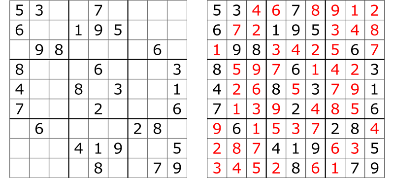

# Sudoku Solver

A sudoku solver written from scratch (NumPy only) using an iterative backtracking depth-first search.



## How it works

The notebook [`sudoku.ipynb`](sudoku.ipynb) implements `sudoku_solver(sudoku)`, which takes a 9x9 NumPy array (`0` = empty cell) and returns the solved grid, or a 9x9 array of `-1` if the puzzle has no solution.

1. **Initial check**: the grid is validated first; a duplicate number in a row, column or 3x3 block means there is no solution.
2. **Frontier**: cells are visited row by row. For each empty cell, the *frontier* (values consistent with the row, column and block constraints given the cells filled so far) is computed once and stored in a 9x9 dictionary.
3. **Assignment**: a value is picked from the frontier and removed from it, so it is not retried until the earlier cells change.
4. **Backtracking**: when a cell has an empty frontier, the search goes back to the previous empty cell with values left, resetting the cells in between to `0`. If it goes back past the first cell, the puzzle is unsolvable and the `-1` grid is returned.

The original puzzle is kept in memory to know which cells are fixed. Worst-case time is O(9^m), with m the number of empty cells; extra space is O(1) in the grid size.

### Optimisation
The block constraint check was rewritten to look directly at the grid cells instead of building an array for the 3x3 block and searching it, which removes a constant factor: on one hard puzzle the average solve time dropped from about 10.0 s to about 6.1 s.

### Possible improvements
* A *minimum remaining values* heuristic (fill the most constrained cells first) to shrink the search tree.
* A recursive formulation that avoids managing the frontier by indexes.
* Updating the frontiers of connected cells as soon as a value is placed, to detect dead ends immediately.

## Data

`data/` contains 15 puzzles and their solutions for each of four difficulty levels (`very_easy`, `easy`, `medium`, `hard`) as `.npy` arrays of shape `(15, 9, 9)`.

## Results

The notebook validates the solver against every provided solution. All 60 puzzles are solved correctly; the hard set takes about 26 s in total (the very easy, easy and medium sets take well under a second each). Timings depend on the machine and on the random choices made during the search.

## Running

```bash
pip install -r requirements.txt
jupyter notebook sudoku.ipynb
```

## License
MIT
